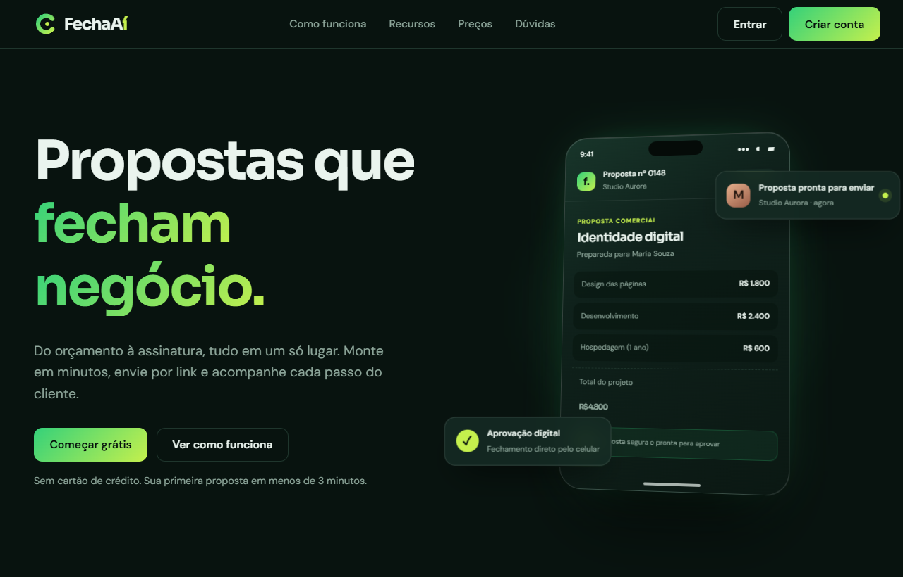

# FechaAí

Landing page responsiva para uma plataforma de propostas comerciais: uma experiência visual para apresentar serviços, acompanhar uma proposta pelo celular e destacar planos e recursos.

<p align="center">
  
</p>

<p align="center">
  
</p>

## Sobre o projeto

O projeto reúne uma página de apresentação em português com foco em tornar o fluxo de propostas comerciais fácil de entender em diferentes tamanhos de tela. O mockup do celular acompanha a rolagem da hero section, e a página inclui seções sobre o fluxo de trabalho, recursos, preços e dúvidas frequentes.

> **Escopo:** este repositório contém a interface front-end. Ações como criar conta, entrar e assinar planos são demonstrativas e ainda não estão conectadas a uma API, autenticação ou pagamento.

## Recursos da interface

- Layout responsivo para desktop e dispositivos móveis.
- Hero section com mockup de proposta em formato de celular e animação 3D vinculada à rolagem.
- Demonstração visual das etapas de uma proposta comercial.
- Seção interativa “Como funciona”, com etapas selecionáveis.
- Apresentação de recursos em cards e gráfico ilustrativo.
- Alternância visual entre preços mensais e anuais.
- Perguntas frequentes em formato expansível.
- Suporte à preferência do sistema por movimento reduzido.

## Tecnologias

- [React](https://react.dev/) — componentes e estado da interface.
- [Vite](https://vite.dev/) — servidor de desenvolvimento e build.
- [HTM](https://github.com/developit/htm) — templates de interface com sintaxe semelhante a JSX.
- CSS — estilos, responsividade e animações.

## Começar

### Pré-requisitos

- Node.js 18 ou superior.
- npm.

### Instalação e desenvolvimento

```bash
git clone <URL_DO_REPOSITORIO>
cd FechaAi
npm install
npm run dev
```

O Vite informa no terminal o endereço local da aplicação após iniciar o servidor.

### Build de produção

```bash
npm run build
npm run preview
```

Os arquivos de produção são gerados no diretório `dist/`.

## Scripts disponíveis

| Comando | Descrição |
| --- | --- |
| `npm run dev` | Inicia o servidor de desenvolvimento do Vite. |
| `npm run build` | Gera a versão de produção em `dist/`. |
| `npm run preview` | Serve localmente a versão de produção. |

## Estrutura do projeto

```text
FechaAi/
├── public/
│   └── images/          # Capturas usadas neste README
├── src/
│   ├── App.jsx          # Componentes e conteúdo da página
│   ├── main.jsx         # Inicialização do React
│   └── styles.css       # Estilos e animações
├── index.html           # Documento HTML de entrada
├── package.json         # Dependências e scripts npm
└── vite.config.js       # Configuração do Vite
```

## Imagens

As capturas de tela do README estão em `public/images/` e também podem ser visualizadas diretamente:

- [Visualização desktop](public/images/fechaai-desktop.png)
- [Visualização mobile](public/images/fechaai-mobile.png)

## Licença

Nenhuma licença foi definida neste repositório até o momento.
